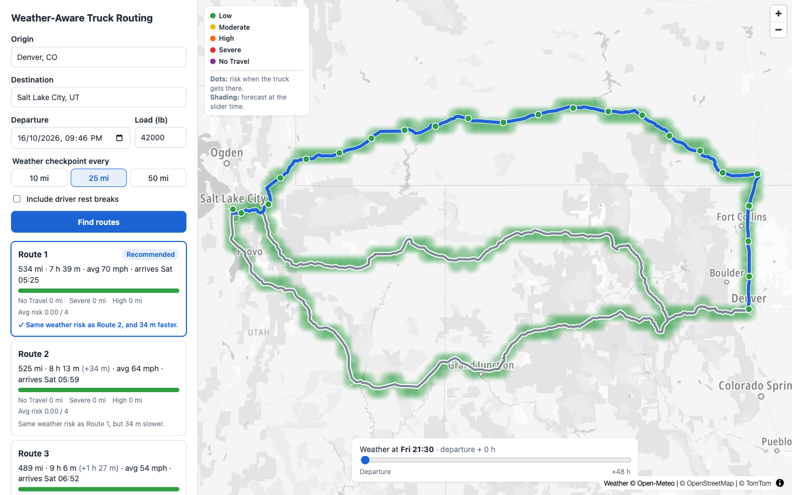

# Weather-Aware Truck Routing

A React + Django app that helps a truck driver choose the safest route. It compares up to 3 truck routes using the weather forecast **at the time the truck reaches each point**, the load weight, and travel time.

**Live app:** https://spotter-truck-routing-ui.onrender.com · **Loom walkthrough:** _TODO: add link_ · **Docs:** [Scope](docs/SCOPE.md) · [Architecture](docs/ARCHITECTURE.md) · [Decision records](docs/adr/README.md)

> The backend runs on Render's free plan and sleeps after 15 minutes idle. The first search after that takes about a minute while it wakes up. The app shows a "Waking up the server…" message meanwhile.



---

## Requirements → implementation

| Brief | How it is met |
|---|---|
| Origin, destination, departure time, load weight | Form with US-only autocomplete (300 ms debounce, cached geocoding) |
| 3 route options from a routing API | TomTom truck routing with load weight. If fewer than 3 distinct routes come back, one extra request avoids the main route's midpoint |
| Weather every 10 / 25 / 50 mi at the truck's ETA | Checkpoints every N miles plus the destination. ETAs come from TomTom's traffic-aware travel times, with optional driver rest breaks |
| Risk from the risk and load rules | Worst of wind, rain, and snow, then the load rules can raise it. The reasons are shown in each checkpoint popup |
| Recommend the best route | Ranked by the brief's order (see below), with a plain-English reason on each route card |
| Routes, checkpoints, risk, ETAs, summaries on a map | MapLibre + TomTom vector map. Click a route card or line to select it. Checkpoint popups show ETA, wind, gusts, rain, snow, and risk |
| Weather heatmap along the corridor with a 0–48 h slider | All 48 hours load with the plan. Moving the slider only re-colours GPU circles, with no network request |

## How a plan is made

`POST /api/plan` → [`plan_trip()`](backend/trip_planning/service.py):

1. **Routes:** one TomTom truck request for the main route and 2 alternatives. Keep the ones that are distinct from each other, and make one fallback request if fewer than 3 remain.
2. **Checkpoints:** every N miles along each route, each with an ETA (departure + travel time + any rest breaks).
3. **Weather locations:** every checkpoint plus a point every 5 miles of road, rounded to about 7 miles so nearby points share one forecast.
4. **Weather:** **one bulk Open-Meteo request** for all locations, cached for 60 minutes.
5. **Risk:** each checkpoint at its ETA hour, and each heatmap point for each of the 48 hours.
6. **Ranking:** add up the miles at each risk level per route, rank the routes, and explain the result.

The trip-planning logic is pure Python with no Django or HTTP. Provider functions are passed in, so the whole pipeline is tested with fakes. Details: [ARCHITECTURE.md](docs/ARCHITECTURE.md).

## Risk and recommendation logic

The brief leaves some cases open. These are the interpretations used (full table in [SCOPE.md](docs/SCOPE.md#rule-interpretations)):

| Question | Interpretation |
|---|---|
| A value on a shared boundary (rain 0.25 is in both "0.10–0.25" and "0.25–0.50") | It goes into the **higher** band. The No Travel limits are strict (`>1.00` rain, `>3.0` snow), as written in the brief. |
| Several conditions at once | Risk is the **worst** of wind, rain, and snow, then the load rules are applied. Load rules can only raise the level. |
| Which wind value | Sustained wind at 10 m. Gusts are shown for information only. |
| Rain rate | Open-Meteo `rain + showers`, so thunderstorm downpours count. |
| Forecast at the ETA | Rain and snow use the hour containing the ETA. Wind uses the nearest hour. |
| Miles at a risk level | Each checkpoint covers the road from it to the next checkpoint. |

**Ranking** (each rule only matters when the routes tie on the rules above it):

1. Fewest **No Travel** miles. *Added*: the brief's list starts at Severe, but a route with No Travel miles must never beat one without. If every route has some, the app shows a warning.
2. Fewest Severe miles.
3. Fewest High miles.
4. Lowest mile-weighted average risk (Low = 0 … No Travel = 4, rounded to 2 decimals).
5. Shortest travel time.

Each route card says which rule decided its place, for example *"Same weather risk as Route 2, and 34 m faster."* The app also includes a collapsible "How routes are ranked" panel. See [ADR-0007](docs/adr/0007-risk-classification-and-ranking.md).

## Map and heatmap performance

- **All 48 hours load once** with the plan: one risk value per hour for each heatmap point. The slider makes no network request.
- **One style change per slider move.** Moving the slider updates a single MapLibre paint expression, at most once per animation frame. The data and the other layers stay untouched, and the GPU re-colours the circles.
- The weather layer sits **under the map labels**, so place names stay readable.
- **Measured:** sweeping the slider from 0 to 47 h in 471 steps, one step per frame, on Chromium on an Apple M4 Pro with a 120 Hz display (8.3 ms frames) and the dev build. **No dropped frames.** The slowest frame took 9.4 ms against the 16 ms budget, and the React update took 1.2 ms on median (3.5 ms worst).

## Key decisions

| Decision | Why | ADR |
|---|---|---|
| Pre-trip planner, not live tracking | Answers "which route if I leave at this time?" well, instead of a weak live system | [0001](docs/adr/0001-pre-trip-planner-not-live-tracking.md) |
| TomTom for routing, search, and the map | Truck-aware routing (load weight) and alternatives on a free tier, all from one provider | [0002](docs/adr/0002-tomtom-for-routing-geocoding-and-map.md) |
| Open-Meteo, one bulk request per plan | Free hourly forecasts with no key. Bulk requests keep a plan to one call | [0003](docs/adr/0003-open-meteo-for-weather.md) |
| Backend proxies all data APIs, with caching | Keeps the TomTom key secret and saves the free quota | [0004](docs/adr/0004-backend-proxies-third-party-apis.md) |
| Alternatives + avoid-area fallback for 3 routes | TomTom alone often returns fewer than 3 distinct routes | [0005](docs/adr/0005-three-route-strategy.md) |
| Forecast matched to each checkpoint's ETA | The brief's core requirement: weather when the truck is there, not now | [0006](docs/adr/0006-checkpoint-eta-and-forecast-matching.md) |
| GPU circles with 48 h preloaded | A smooth slider with no requests. Colour shows risk, not point density | [0009](docs/adr/0009-maplibre-heatmap-with-preloaded-48h-data.md) |
| In-process cache, 1 Gunicorn worker × 4 threads | One shared cache, low memory on a 512 MB instance, slow API calls don't block others | [0013](docs/adr/0013-in-process-cache-and-gunicorn-threads.md) |
| Render: Docker backend + static frontend | Free with no card. The static site never sleeps | [0015](docs/adr/0015-docker-render-hosting-and-makefile.md) |

All 15 decisions: [docs/adr/](docs/adr/README.md).

## Run locally

You need two free TomTom keys from [developer.tomtom.com](https://developer.tomtom.com/). Open-Meteo needs no key.

```bash
cp .env.example .env
# TOMTOM_API_KEY      server key (Search + Routing)
# VITE_TOMTOM_MAP_KEY browser key (Map Display only; restrict it to your domain when deployed)
```

**With Docker** (nothing else to install):
```bash
make up      # app → http://localhost:8080, API → http://localhost:8000
make down
```

**Without Docker** (Python 3.14 + [uv](https://docs.astral.sh/uv/), Node 24):
```bash
make install
make dev     # app → http://localhost:5173, API → http://localhost:8000
```

**Checks:**
```bash
make test    # pytest + Vitest
make lint    # ruff + oxlint + tsc
```

## Deployment (Render)

| Service | Type | Settings |
|---|---|---|
| Backend | Web service from `backend/Dockerfile` | Health check `/api/health`. Env: `TOMTOM_API_KEY`, `DJANGO_SECRET_KEY`, `DEBUG=false`, `LOG_FORMAT=json`, `CORS_ALLOWED_ORIGINS=<frontend URL>` |
| Frontend | Static site | Root `frontend`, build `npm ci && npm run build`, publish `dist`. Env: `NODE_VERSION=24`, `VITE_API_BASE_URL=<backend URL>`, `VITE_TOMTOM_MAP_KEY` |

`ALLOWED_HOSTS` doesn't need setting on Render, because the backend adds Render's own hostname. `VITE_*` values are built into the bundle, so changing one needs a frontend redeploy.

## Limitations

- **Contiguous US only.** Origins and destinations elsewhere are rejected.
- **Weather hazards:** only wind, rain, and snow. Ice, fog, visibility, and official alerts are not included.
- **ETAs** assume an on-time departure and no unplanned stops. Rest breaks are a simplified version of the Hours-of-Service rules.
- **Free API quotas:** roughly 18–20 new searches a day fit within Open-Meteo's free limit, and a second new search in the same minute may be refused. Repeated searches are served from the cache. When a quota is hit, the app shows a clear error.
- **Cold start:** about a minute on the first request after the free backend has been idle.

The full list is in [SCOPE.md → Out of scope](docs/SCOPE.md#out-of-scope).

## Project structure

```
backend/
  api/              DRF serializers + views (the only HTTP layer)
  trip_planning/    pure logic: risk, checkpoints, ETAs, ranking, heatmap, plan_trip()
  providers/        TomTom + Open-Meteo clients
  core/             logging, request IDs, error handling
  tests/
frontend/src/
  api/  hooks/  lib/  components/  components/map/
docs/               SCOPE, ARCHITECTURE, ADRs
```
